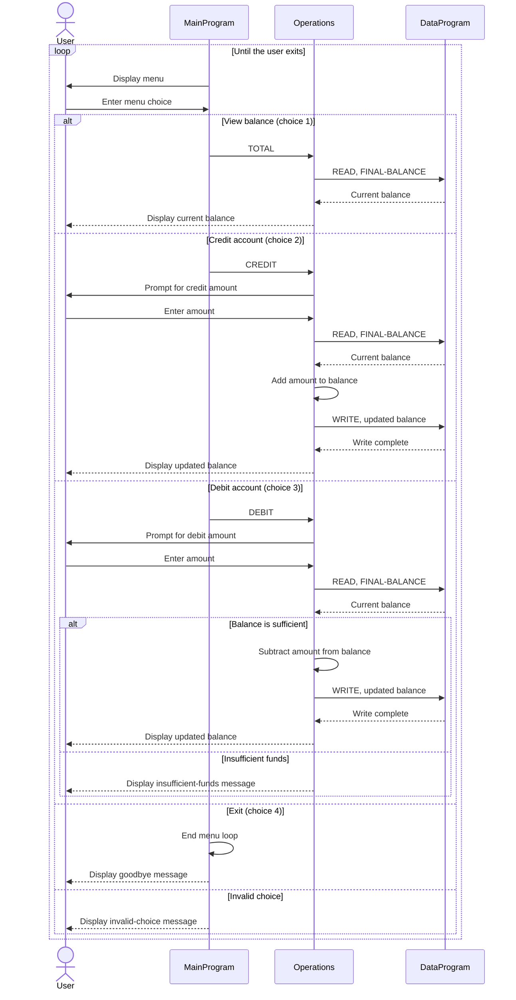

# COBOL Student Account Management

This directory documents the COBOL account-management example in `src/cobol`. The programs provide a console menu for viewing and changing a single account balance. Although this project frames the account as a student account, the current implementation does not store student names, IDs, or multiple student records.

## Program Files

### `src/cobol/main.cob` - `MainProgram`

Provides the interactive console menu and controls the main program loop.

- Displays options to view a balance, credit the account, debit the account, or exit.
- Reads the user's menu choice and calls `Operations` with `TOTAL`, `CREDIT`, or `DEBIT`.
- Rejects menu choices outside 1-4 with an error message.
- Ends the loop and stops the program when the user chooses option 4.

### `src/cobol/operations.cob` - `Operations`

Implements the account actions requested by `MainProgram`.

- `TOTAL`: reads and displays the current balance.
- `CREDIT`: prompts for an amount, reads the balance, adds the amount, writes the result, and displays the updated balance.
- `DEBIT`: prompts for an amount, reads the balance, and subtracts it only if the balance is at least the requested amount. Otherwise, it displays an insufficient-funds message.

### `src/cobol/data.cob` - `DataProgram`

Holds the account balance and provides simple read/write access to it.

- Initializes `STORAGE-BALANCE` to `1000.00`.
- For a `READ` operation, copies the stored balance to the caller's balance field.
- For a `WRITE` operation, copies the caller's balance into storage.

## Student Account Rules and Limitations

- The account starts with a balance of **$1,000.00**.
- A debit is accepted only when the current balance is greater than or equal to the debit amount; this prevents the balance from going below zero for ordinary positive amounts.
- A credit adds the entered amount to the balance.
- The programs do not validate that entered amounts are positive. Zero or negative values can therefore produce unexpected results (for example, a negative credit reduces the balance).
- The balance is held in COBOL working storage, not a file or database. No student identity or account records are persisted, and this example is not a multi-student account system.
- Balance fields use `PIC 9(6)V99`, which represents an unsigned value with up to six whole-number digits and two decimal places. The programs do not include explicit checks for values outside that field's capacity.

## Call Flow

`MainProgram` reads a menu choice and calls `Operations`. `Operations` handles the requested action and calls `DataProgram` to read or write the balance. `DataProgram` returns control to `Operations`, which displays the result before returning to the menu.

## Sequence Diagram

